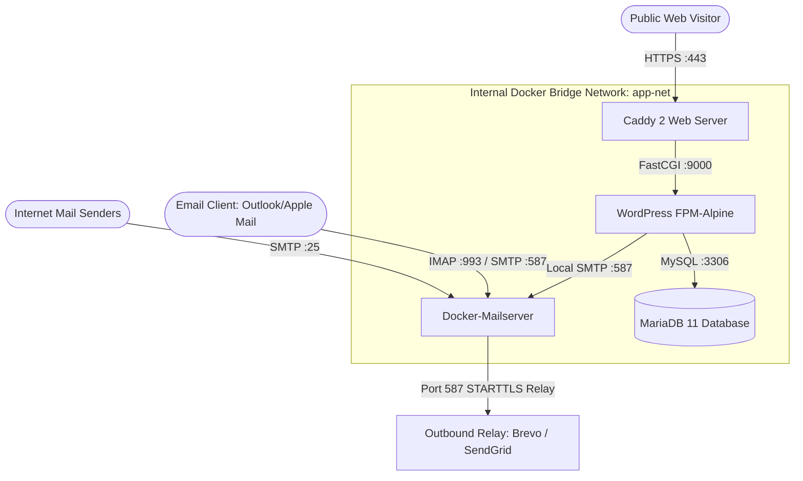
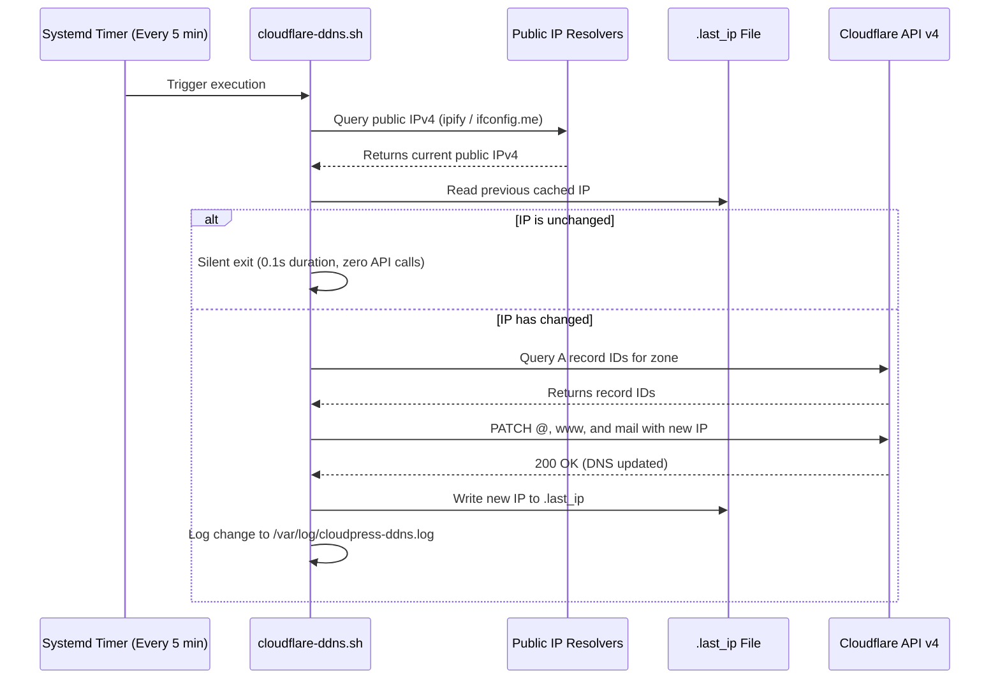

# CloudPress: Comprehensive System & Technical Documentation

This document serves as the authoritative technical reference manual, operational guide, and architecture specification for **CloudPress**.

---

## Table of Contents

1. [Executive Overview](#1-executive-overview)
2. [Architecture & Cloud Infrastructure](#2-architecture--cloud-infrastructure)
   - [2.1 Google Cloud Platform (Always Free Tier)](#21-google-cloud-platform-always-free-tier)
   - [2.2 Server Container Stack](#22-server-container-stack)
   - [2.3 Cloudflare DNS & Security Topology](#23-cloudflare-dns--security-topology)
3. [End-to-End Deployment Pipeline](#3-end-to-end-deployment-pipeline)
   - [Stage 1: VM Provisioning & Firewall Configuration](#stage-1-vm-provisioning--firewall-configuration)
   - [Stage 2: Initial Cloudflare DNS Setup](#stage-2-initial-cloudflare-dns-setup)
   - [Stage 3: SSH Bootstrapping & File Transfer](#stage-3-ssh-bootstrapping--file-transfer)
   - [Stage 4: Container Stack Initialization](#stage-4-container-stack-initialization)
   - [Stage 5: OpenDKIM Cryptographic Key Generation](#stage-5-opendkim-cryptographic-key-generation)
   - [Stage 6: WordPress Core Installation & SMTP Injection](#stage-6-wordpress-core-installation--smtp-injection)
4. [Autonomous Dynamic DNS (DDNS) Subsystem](#4-autonomous-dynamic-dns-ddns-subsystem)
5. [Security, Privacy & Credential Lifecycle](#5-security-privacy--credential-lifecycle)
6. [Desktop Application Internals](#6-desktop-application-internals)
   - [6.1 IPC & Event Streaming Model](#61-ipc--event-streaming-model)
   - [6.2 Windowless Execution Engine](#62-windowless-execution-engine)
   - [6.3 Web Audio Synthesized Success Chime](#63-web-audio-synthesized-success-chime)
   - [6.4 Dynamic Viewport Clearance Engine](#64-dynamic-viewport-clearance-engine)
7. [Remote Server Operations & Maintenance Handbook](#7-remote-server-operations--maintenance-handbook)
   - [7.1 SSH Connection](#71-ssh-connection)
   - [7.2 Docker Stack Management](#72-docker-stack-management)
   - [7.3 Mailbox Management](#73-mailbox-management)
   - [7.4 Inspecting Dynamic DNS Logs](#74-inspecting-dynamic-dns-logs)
   - [7.5 Backup & Disaster Recovery](#75-backup--disaster-recovery)
8. [Troubleshooting & Frequently Asked Questions](#8-troubleshooting--frequently-asked-questions)

---

## 1. Executive Overview

**CloudPress** is a zero-configuration cloud deployment system packaged as a modern desktop application. It eliminates the traditional DevOps barrier for self-hosting WordPress, enabling creators, freelancers, and businesses to deploy an enterprise-grade WordPress website and custom business mail server with **$0 recurring hosting bills**.

### Core Value Proposition

| Traditional Shared Hosting | Typical Cloud VPS Setup | CloudPress |
| :--- | :--- | :--- |
| $5–$25/month recurring fees | Requires advanced Linux & Docker CLI knowledge | **$0/month forever** on Google Cloud Always Free tier |
| No custom business email or expensive add-on | Manual Postfix/Dovecot configuration | **Included**: Containerized Docker-Mailserver with DKIM/SPF |
| Sluggish shared servers & upsells | 20+ hours of manual setup and debugging | **Fully automated** in ~5 minutes via one-click desktop app |
| Locked into proprietary cPanel | Vulnerable to IP reassignments & misconfigurations | **Auto-healing Dynamic DNS** & Cloudflare integration |

---

## 2. Architecture & Cloud Infrastructure

### 2.1 Google Cloud Platform (Always Free Tier)

CloudPress provisions an **e2-micro** virtual machine instance on Google Compute Engine, taking full advantage of Google's generous Always Free tier:

* **Machine Type**: `e2-micro` (2 vCPUs burstable, 1.0 GB physical RAM).
* **Operating System**: Ubuntu 24.04 LTS AMD64 minimal base image.
* **Storage**: 30 GB standard persistent disk (`pd-standard`).
* **Eligible Regions**:
  * `us-central1` (Iowa, USA) — *Recommended default*
  * `us-west1` (Oregon, USA)
  * `us-east1` (South Carolina, USA)
* **Memory Optimization**: Because 1.0 GB of RAM can be constrained during intensive operations (such as container image pulls or plugin installations), CloudPress automatically creates and mounts a **3 GB swapfile** (`/swapfile`), providing 4 GB of total effective memory for rock-solid stability.

### 2.2 Server Container Stack

All services on the server run inside isolated Docker containers managed by Docker Compose in `/opt/wp-deployer/`:

```
/opt/wp-deployer/
├── docker-compose.yml          # Container topology & resource bindings
├── Caddyfile                   # Web routing & automated TLS certificate rules
├── .env                        # Root-only credentials (chmod 600)
├── cloudflare-ddns.sh          # Auto Dynamic DNS updater script
└── bootstrap.sh                # Initial server setup and container startup
```



#### Services Breakdown:

1. **Caddy 2 (`caddy:2-alpine`)**:
   * Functions as the high-performance reverse proxy and edge router.
   * Automatically requests, validates, and renews **Let's Encrypt / ZeroSSL** certificates via HTTP-01 challenges.
   * Gzip, Zstandard, and modern FastCGI response caching enabled.
2. **WordPress FPM (`wordpress:fpm-alpine`)**:
   * Official lightweight Alpine Linux build using PHP 8.2+ FastCGI Process Manager.
   * Pre-configured with clean uploads directories, proper permissions (`www-data:www-data`), and automated SSL headers.
3. **MariaDB 11 (`mariadb:11`)**:
   * Enterprise-ready relational database configured with `utf8mb4_unicode_ci`.
   * Tuned for 1 GB RAM systems with a conservative `innodb_buffer_pool_size=256M` buffer to avoid out-of-memory kernel kills.
4. **Docker-Mailserver (`mailserver/docker-mailserver:latest`)**:
   * Production-grade email server running Postfix, Dovecot, OpenDKIM, and Fail2ban.
   * Exposes ports 25 (SMTP reception), 587 (Submission with STARTTLS), and 993 (IMAP SSL).
5. **WP-CLI Utility (`wordpress:cli`)**:
   * Automates `wp core install` and configuration generation without requiring browser-based web installation screens.

### 2.3 Cloudflare DNS & Security Topology

CloudPress configures your domain records via the Cloudflare API v4:

| Record Type | Host | Points To | Proxy Status | Description |
| :--- | :--- | :--- | :--- | :--- |
| **A** | `@` (apex) | VM Public IPv4 | **Proxied** (Orange Cloud) | Web traffic routed through Cloudflare CDN & DDoS protection |
| **A** | `www` | VM Public IPv4 | **Proxied** (Orange Cloud) | Subdomain routing matching apex |
| **A** | `mail` | VM Public IPv4 | **DNS Only** (Grey Cloud) | Direct server routing (mail ports must bypass HTTP proxy) |
| **MX** | `@` | `mail.yourdomain.com` | **DNS Only** (Priority 10) | Directs global inbound email to your Docker-Mailserver |
| **TXT** | `@` (SPF) | `v=spf1 mx include:... ~all` | **DNS Only** | Sender Policy Framework anti-spoofing policy |
| **TXT** | `_dmarc` | `v=DMARC1; p=quarantine;` | **DNS Only** | Domain-based Message Authentication & Reporting policy |
| **TXT** | `mail._domainkey` | Cryptographic Public Key | **DNS Only** | OpenDKIM signature for verified inbox deliverability |

---

## 3. End-to-End Deployment Pipeline

When you click **Start Automated Deployment**, the application executes a state-machine progression across 6 distinct stages:

```
[Stage 1: GCP Provisioning] ➔ [Stage 2: Cloudflare DNS] ➔ [Stage 3: SSH Bootstrap]
                                                                  │
[Stage 6: WP & SMTP Live]   ⬅ [Stage 5: OpenDKIM Sync]   ⬅ [Stage 4: Docker Compose]
```

### Stage 1: VM Provisioning & Firewall Configuration
1. Connects to Google Cloud via OAuth 2.0 PKCE or Service Account JWT.
2. Checks if an instance named `cloudpress-vm-<timestamp>` already exists.
3. Creates a new VM instance with the specified zone and specifications.
4. Injects the Ed25519 SSH public key into instance metadata (`ubuntu:<key>`).
5. Ensures firewall rule `cloudpress-allow-web-mail` exists, allowing ports `22, 80, 443, 25, 587, 993`.
6. Polls the GCP instance status until it transitions to `RUNNING` and extracts the assigned external IPv4 address.

### Stage 2: Initial Cloudflare DNS Setup
1. Queries the Cloudflare API to verify the Zone ID for your domain.
2. Checks for conflicting existing `A`, `CNAME`, or `MX` records (prompting the user if existing records are found).
3. Upserts the `A` records for `@`, `www`, and `mail`.
4. Creates the `MX`, SPF `TXT`, and `_dmarc` records.

### Stage 3: SSH Bootstrapping & File Transfer
1. Connects to the VM via SSH (`ubuntu@<vm_ip>`).
2. Creates `/opt/wp-deployer` and applies `755` ownership permissions.
3. Dynamically renders configuration templates in memory:
   * `docker-compose.yml`
   * `Caddyfile`
   * `.env` (including Cloudflare API credentials for the DDNS agent)
   * `cloudflare-ddns.sh`
   * `bootstrap.sh`
4. Uploads each configuration file to the VM via SSH base64 streaming.

### Stage 4: Container Stack Initialization
1. Executes `bootstrap.sh` remotely with real-time stdout/stderr streaming into the desktop app log panel.
2. Creates the 3 GB `/swapfile` if not already present.
3. Configures UFW and iptables port forwarding rules.
4. Installs the Docker Engine and Docker Compose plugin if missing.
5. Runs `docker compose pull` and `docker compose up -d`.

### Stage 5: OpenDKIM Cryptographic Key Generation
1. Creates the mail user account inside `mailserver` using `setup email add`.
2. Generates a 2048-bit RSA/Ed25519 OpenDKIM keypair for your domain inside the container.
3. Extracts the public key string from `/tmp/docker-mailserver/opendkim/keys/<domain>/mail.txt`.
4. Transmits the public key via Cloudflare API v4 as a `TXT` record at `mail._domainkey.<domain>`.

### Stage 6: WordPress Core Installation & SMTP Injection
1. Polls the WordPress volume until core PHP files are extracted.
2. Waits for MariaDB to report readiness over the internal bridge network.
3. Executes `wp-cli wp config create` with database parameters.
4. Executes `wp-cli wp core install` with your specified site title, admin username, and password.
5. Drops `smtp.php` into `/var/www/html/wp-content/mu-plugins/` (a Must-Use WordPress plugin that hooks `phpmailer_init` to route outbound emails through the local container).
6. Restarts the WordPress container to initialize connections.
7. Emits a completion event, triggers desktop notifications, and plays the success chime.

---

## 4. Autonomous Dynamic DNS (DDNS) Subsystem

### The Challenge of Ephemeral Cloud IPs
By default, Google Cloud external IPs on Always Free instances are **ephemeral**. While regular OS reboots (`sudo reboot`) preserve the IP, **stopping the instance in the Google Cloud Console and starting it again causes Google to reassign a new external IP**.

### The Solution: Embedded Server-Side Daemon
CloudPress deploys an autonomous Dynamic DNS background agent on the server:

* **File Location**: `/opt/wp-deployer/cloudflare-ddns.sh`
* **Execution Daemon**: Systemd timer (`cloudpress-ddns.timer`) triggering `cloudpress-ddns.service`.
* **Cadence**:
  * **On Boot**: 1 minute after system startup (`OnBootSec=1min`).
  * **Recurring**: Every 5 minutes (`OnUnitActiveSec=5min`).



---

## 5. Security, Privacy & Credential Lifecycle

Security and credential isolation are primary architectural principles of CloudPress:

### Ephemeral In-Memory Model
* All passwords, Google OAuth tokens, Cloudflare tokens, and private keys reside in **volatile memory only** during app execution.
* The application does **not** write to browser `localStorage`, `sessionStorage`, or cookies. Closing the window completely purges the memory space.

### Local Profile Storage (`~/.cloudpress/profile.json`)
* Credentials are saved to disk **only if you explicitly click the "Save Progress" button** in the header.
* Stored strictly in the user's personal home directory (`$HOME/.cloudpress/profile.json`), never in the git working tree or shared locations.

### Windows Subprocess ACL Isolation
* When private keys are temporarily written to `%TEMP%\cloudpress_key_<uuid>` for SSH transport, Windows Access Control Lists (ACLs) are immediately configured:
  ```powershell
  icacls <path> /inheritance:r
  icacls <path> /grant:r <username>:(R,W)
  ```
* This strips all inherited permissions and guarantees that **no other user account or background service on the PC can read the key**.
* As soon as deployment finishes (or in the event of an error/cancellation), `std::fs::remove_file()` deletes the key.

### Remote Server Hardening
* The server configuration file `/opt/wp-deployer/.env` is assigned mode `600` and owned by `root:root`.
* MariaDB and internal WordPress FastCGI ports are bound exclusively to the private Docker bridge network (`app-net`) and are **not accessible from the public internet**.

---

## 6. Desktop Application Internals

### 6.1 IPC & Event Streaming Model
CloudPress communicates between its React 19 frontend and Rust core via Tauri's high-speed Inter-Process Communication (IPC):
* **Commands (`invoke`)**: Asynchronous request/response calls (e.g. `deploy_full_stack`, `save_profile`, `fetch_zone_id`).
* **Event Streams (`emit` / `listen`)**:
  * `deploy-log`: Streams real-time stdout/stderr lines from the remote SSH process directly into the UI terminal.
  * `deploy-stage`: Emits structured JSON events when stages transition between `idle`, `running`, `completed`, and `error`.

### 6.2 Windowless Execution Engine
On Windows, launching child processes from a GUI app without specific flags causes a console window (Command Prompt) to flash on screen. CloudPress wraps all process invocations (`ssh`, `gcloud`, `oci`, `icacls`) using the Win32 creation flag:
```rust
pub const CREATE_NO_WINDOW: u32 = 0x08000000;
```
This guarantees 100% silent background execution while capturing all stdout/stderr streams cleanly.

### 6.3 Web Audio Synthesized Success Chime
Rather than bundling bulky `.mp3` audio files that might fail to load, CloudPress synthesizes a celebratory, shimmering success chime directly in real time using the **Web Audio API**:
* Ascending 4-note major arpeggio: **C5 (523.25 Hz) ➔ E5 (659.25 Hz) ➔ G5 (783.99 Hz) ➔ C6 (1046.50 Hz)**.
* Fundamental sine wave combined with an octave-higher overtone (18% gain) for crystalline bell resonance.
* 15ms linear attack followed by natural exponential decay.

### 6.4 Dynamic Viewport Clearance Engine
The layout dynamically calculates bottom padding on the main viewport according to the state of the dockable terminal panel:
* **Terminal Closed**: `5rem` (80px) padding.
* **Terminal Open (Standard)**: `calc(18rem + 3.5rem)` (~344px) padding.
* **Terminal Maximized**: `calc(75vh + 3.5rem)` padding.

This ensures you can always scroll smoothly to the very bottom of the page content without any form elements or buttons being obscured by the bottom panel.

---

## 7. Remote Server Operations & Maintenance Handbook

### 7.1 SSH Connection
To connect directly to your server:
```bash
ssh -i /path/to/your/private_key.pem ubuntu@<your_vm_ip>
```
*(If you used CloudPress to auto-generate keys and saved your profile, the private key is located in your saved `profile.json`).*

### 7.2 Docker Stack Management
All management is performed in the `/opt/wp-deployer` directory:
```bash
cd /opt/wp-deployer

# View status of all running containers
sudo docker compose ps

# View live container logs
sudo docker compose logs -f caddy
sudo docker compose logs -f wordpress
sudo docker compose logs -f mailserver

# Restart the entire stack
sudo docker compose restart

# Pull updated container images and recreate
sudo docker compose pull && sudo docker compose up -d
```

### 7.3 Mailbox Management
The mail server includes a command-line administration utility:
```bash
# Add a new email account
sudo docker exec -ti mailserver setup email add sales@yourdomain.com "SecurePassword123"

# List all configured accounts
sudo docker exec -ti mailserver setup email list

# Change an account password
sudo docker exec -ti mailserver setup email update sales@yourdomain.com "NewPassword456"

# Delete an account
sudo docker exec -ti mailserver setup email del sales@yourdomain.com
```

### 7.4 Inspecting Dynamic DNS Logs
To check the status of your automated IP updater:
```bash
# View the last cached IP
cat /opt/wp-deployer/.last_ip

# View the execution log history
cat /var/log/cloudpress-ddns.log

# Check systemd timer status
systemctl status cloudpress-ddns.timer

# Manually trigger a check
sudo /opt/wp-deployer/cloudflare-ddns.sh
```

### 7.5 Backup & Disaster Recovery

#### Database Backup:
```bash
sudo docker compose exec db mariadb-dump -u wpuser -p"YourDbPassword" wordpress > ~/wordpress_backup_$(date +%F).sql
```

#### Full WordPress Media & Theme Backup:
```bash
sudo tar -czvf ~/wp_files_backup_$(date +%F).tar.gz /var/lib/docker/volumes/wp-deployer_wp_data/_data
```

---

## 8. Troubleshooting & Frequently Asked Questions

### Why can't I send outbound emails directly on port 25?
Most major cloud providers (including Google Cloud, Oracle Cloud, and AWS) permanently block outbound port 25 to prevent spam. 
* **Solution**: In **Step 4 (Business Email)**, CloudPress supports free external SMTP relays like **Brevo (Sendinblue)** (300 free emails/day) or **SendGrid** (100 free emails/day). Emails are relayed securely over port 587 with STARTTLS while incoming emails arrive directly to your server on port 25.

### My SSL certificate shows a warning immediately after deployment.
Cloudflare's default SSL mode might be conflicting with Caddy's auto-generated Let's Encrypt certificates.
* **Fix**: In your Cloudflare Dashboard, go to **SSL/TLS** and change the encryption mode from *Flexible* to **Full (Strict)**.

### How do I delete the server if I want to start over?
1. In CloudPress, navigate to **Step 5 (Review & Launch)**.
2. Click **Teardown & Delete Google Cloud VM**.
3. The app connects to GCP and permanently deletes the VM and its boot disk, preserving your Always Free quota.

---

*Authored by the CloudPress Engineering Team.*
