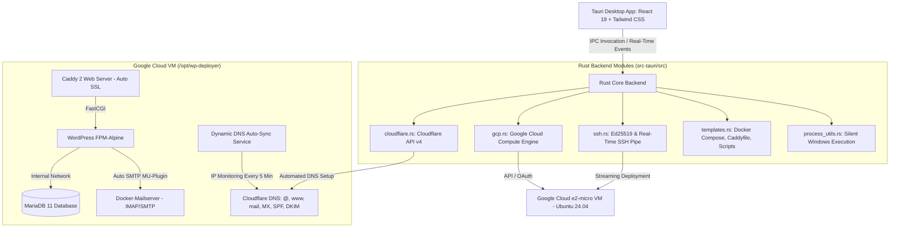

# CloudPress ⚡ Zero-Cost WordPress & Email Deployer

[](https://tauri.app/)
[](https://react.dev/)
[](https://www.rust-lang.org/)
[](https://tailwindcss.com/)
[](https://www.gnu.org/licenses/gpl-3.0)

> **Deploy a high-performance WordPress website and custom business email server onto Google Cloud's Always Free tier in minutes—with zero recurring infrastructure costs, zero coding, and automated Cloudflare DNS configuration.**

---

## 🌟 Highlights & Key Features

* 💸 **100% Zero-Cost Infrastructure**: Runs on Google Cloud's **Always Free `e2-micro`** tier (2 vCPUs burstable, 1 GB RAM, 30 GB standard persistent disk).
* 🔒 **Automatic SSL/TLS**: Managed via **Caddy 2** with automatic Let's Encrypt certificates and modern HTTP/3 + FastCGI optimization.
* 📬 **Full Business Email Stack**: Includes containerized **Docker-Mailserver** with IMAP/SMTP, spam protection, and automated **OpenDKIM** DNS signatures.
* 🌐 **Automated Cloudflare DNS**: One-click provisioning of A, MX, SPF, DMARC, and DKIM records via Cloudflare API v4.
* 🔄 **Built-In Dynamic DNS (DDNS)**: A native server background timer monitors and auto-updates Cloudflare DNS if Google Cloud ever reassigns the VM's external IP.
* 🖥️ **Silent, Windowless Execution**: Background commands (SSH, gcloud, OCI, icacls) execute completely silently without annoying Windows command prompts flashing.
* 🔔 **Instant Desktop & Audio Alerts**: Plays a celebratory audio chime and delivers Windows desktop notifications the moment your stack is ready.
* 🔐 **Privacy-First Security**: Ephemeral in-memory handling; temporary SSH keys are strictly ACL-locked and wiped immediately after deployment.

---

## 🏗️ Architecture Blueprint



---

## 🚀 Quick Start Guide

### Prerequisites

* **Operating System**: Windows 10/11, macOS, or Linux.
* **Google Cloud Account**: A free GCP account with an active project (Compute Engine API enabled).
* **Cloudflare Account**: Your domain active on Cloudflare with an API Token possessing `Zone.DNS:Edit` permissions.
* **Node.js**: v18+ and **Rust**: 1.85+ (only if building from source).

---

### Running the Pre-Built Binary

1. Download the latest `app.exe` release from the releases page.
2. Launch the application.
3. Follow the 5-step interactive wizard:
   * **Step 1: Website**: Name your site, enter your domain, and set your WordPress admin password.
   * **Step 2: Server**: Sign in with Google (OAuth) or paste a Service Account JSON key.
   * **Step 3: Domain**: Enter your Cloudflare API Token (auto-resolves your Zone ID).
   * **Step 4: Email**: Set your business mailbox account (`admin@yourdomain.com`).
   * **Step 5: Launch**: Click **Launch Deployment** and watch the real-time activity log stream.

---

## 🛠️ Building from Source

```bash
# 1. Clone the repository
git clone https://github.com/vickdini/free-wp.git
cd free-wp

# 2. Install frontend dependencies
npm install

# 3. Run in development mode (with Hot Module Replacement)
npx tauri dev

# 4. Compile optimized production executable
npx tauri build --no-bundle
```
The compiled binary will be generated at `src-tauri/target/release/app.exe`.

---

## 📁 Repository Structure

```
free-wp/
├── src/                          # Frontend Application (React 19 + TypeScript)
│   ├── components/               # Step wizards, Header, Terminal, NotificationToast
│   │   ├── Step1Website.tsx      # Domain & WordPress basics
│   │   ├── Step2Server.tsx       # Google Cloud OAuth & SSH key management
│   │   ├── Step3Domain.tsx       # Cloudflare token verification & DNS table
│   │   ├── Step4Email.tsx        # Mailboxes & external SMTP relays
│   │   ├── Step5Launch.tsx       # Review, real-time stage progress & teardown
│   │   ├── Terminal.tsx          # Dockable streaming console panel
│   │   └── NotificationToast.tsx # Celebratory completion toast banner
│   ├── App.tsx                   # Main state machine, stepper & responsive layout
│   └── utils.ts                  # Web Audio arpeggio chime & OS notifications
├── src-tauri/                    # Backend System Core (Rust + Tauri v2)
│   ├── src/
│   │   ├── cloudflare.rs         # Cloudflare DNS API v4 client
│   │   ├── commands.rs           # Tauri IPC commands & orchestration pipeline
│   │   ├── gcp.rs                # Google Cloud Compute API & OAuth 2.0 PKCE flow
│   │   ├── oci.rs                # Oracle Cloud Infrastructure fallback client
│   │   ├── process_utils.rs      # Windowless CREATE_NO_WINDOW command wrapper
│   │   ├── ssh.rs                # Ed25519 key generation & streaming SSH executor
│   │   └── templates.rs          # Docker Compose, Caddyfile, DDNS, & bootstrap scripts
│   ├── Cargo.toml                # Rust crate definitions
│   └── tauri.conf.json           # Tauri security and window configuration
├── DOCUMENTATION.md              # In-depth architectural & operational manual
└── deployment_guide.md           # Deployment technical specifications
```

---

## 🔒 Security & Privacy Architecture

* **Zero External Telemetry**: Your credentials, private keys, and passwords never leave your machine except over encrypted TLS directly to Google Cloud and Cloudflare official endpoints.
* **Ephemeral In-Memory Storage**: Passwords and tokens exist only in volatile RAM during runtime. Closing the window completely clears them.
* **Strict Windows ACL Key Protection**: Temporary private keys are written with `icacls /inheritance:r` to prevent any other local user accounts from reading them, and are auto-deleted immediately upon completion.
* **Isolated Container Networking**: MariaDB and WordPress database ports are bound to an internal Docker network and are **never exposed to the public internet**.

---

## 📄 License

This project is licensed under the [GNU General Public License v3.0](LICENSE) (GPL-3.0).
