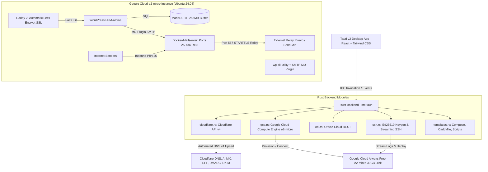

# CloudPress: Zero-Cost Cloud WordPress & Email Deployer

**CloudPress** is a cross-platform desktop application powered by **Tauri v2**, **Rust**, **React 19**, and **Tailwind CSS**. It automates the zero-cost deployment of WordPress and a containerized email server onto a **Google Cloud Platform (GCP) Always Free e2-micro** instance (`us-central1`, `us-west1`, `us-east1` with 30 GB disk) or Oracle Cloud Arm64, wired up automatically via the **Cloudflare API v4**.

---

## 1. Architectural Blueprint

---

## 2. Component Reference

### Backend Rust Modules (`src-tauri/src/`)
| Module | Responsibility | Key Functions / Structs |
| :--- | :--- | :--- |
| [`lib.rs`](file:///d:/free-wp/src-tauri/src/lib.rs) | Tauri v2 application builder, logging plugin, IPC handler dispatch | `run()`, plugin registration |
| [`commands.rs`](file:///d:/free-wp/src-tauri/src/commands.rs) | Tauri commands exposed to the frontend | `deploy_full_stack()`, `generate_ssh_key()`, `fetch_zone_id()`, `test_ssh_connection()`, `save_profile()`, `load_profile()` |
| [`gcp.rs`](file:///d:/free-wp/src-tauri/src/gcp.rs) | Google Cloud Compute Engine `e2-micro` provisioning, OAuth 2.0 PKCE browser sign-in & Service Account API | `provision_vm()`, `start_google_oauth_flow()`, `list_google_projects()`, `ensure_firewall_rules()`, `GcpConfig` |
| [`cloudflare.rs`](file:///d:/free-wp/src-tauri/src/cloudflare.rs) | Cloudflare API v4 integration | `fetch_zone_id()`, `upsert_dns_record()`, `configure_initial_dns()`, `push_dkim_record()`, `parse_opendkim_key()` |
| [`oci.rs`](file:///d:/free-wp/src-tauri/src/oci.rs) | Oracle Cloud VM provisioning & out-of-capacity auto-retry | `provision_arm64_instance()`, `sign_request()`, `open_security_list_ports()`, `OciConfig` |
| [`ssh.rs`](file:///d:/free-wp/src-tauri/src/ssh.rs) | Ed25519 key generation & real-time streaming remote execution | `generate_ed25519_keypair()`, `test_connection()`, `upload_file_content()`, `run_bootstrap_stream()` |
| [`templates.rs`](file:///d:/free-wp/src-tauri/src/templates.rs) | Dynamic in-memory generation of container configs & scripts | `docker_compose()`, `caddyfile()`, `env_file()`, `bootstrap_sh()`, `wp_smtp_mu_plugin()` |

---

## 3. Deployment Flow (6 Automated Stages)

1. **Stage 1: Provisioning Google Cloud e2-micro VM & Firewall**
   - Connects to Google Cloud via 1-click **Google OAuth 2.0 PKCE** in the browser or Service Account JSON key.
   - Automatically retrieves and lists your Google Cloud projects.
   - Provisions an Always Free `e2-micro` instance (2 vCPUs burstable, 1 GB memory, 30 GB standard persistent disk, Ubuntu 24.04 LTS) in `us-central1` (Iowa), `us-west1` (Oregon), or `us-east1` (South Carolina).
   - Automatically injects the high-security Ed25519 SSH public key into VM metadata (`ubuntu`).
   - Automatically creates Google Cloud firewall rule `cloudpress-allow-web-mail` opening ports `80, 443, 22, 25, 587, 993`.
   - Polls until the VM is `RUNNING` and captures the external Public IPv4 address.

2. **Stage 2: Configuring Initial Cloudflare DNS**
   - Queries Cloudflare API for the Zone ID matching your apex domain.
   - Upserts `A` records for `@`, `www`, and `mail` pointing directly to the VM IP (Proxy initially OFF for ACME challenges).
   - Configures `MX` record pointing to `mail.{domain}` with Priority 10.
   - Creates SPF `TXT` record (`v=spf1 mx include:{relay_domain} ~all`) and `_dmarc` policy.

3. **Stage 3: Bootstrapping Server via SSH**
   - Connects to `ubuntu@{vm_ip}:22` using generated or custom Ed25519 private key.
   - Creates `/opt/wp-deployer` deployment workspace on the server.
   - Generates and uploads `docker-compose.yml`, `Caddyfile`, `.env`, and `bootstrap.sh`.

4. **Stage 4: Deploying Docker Compose Stack**
   - Configures 2GB swapfile for rock-solid stability.
   - Flushes restrictive default Oracle Cloud `iptables` rules and opens required ports.
   - Installs Docker Engine & Compose plugin if not already present.
   - Launches Caddy 2, WordPress FPM, MariaDB 11, and Docker-Mailserver.

5. **Stage 5: Extracting OpenDKIM & Pushing DNS Records**
   - Runs `docker exec mailserver setup config dkim domain {domain}`.
   - Streams OpenDKIM public key from the container.
   - Pushes `mail._domainkey` `TXT` record directly to Cloudflare DNS via API.

6. **Stage 6: Finalizing WordPress & SMTP**
   - Executes `wp core install` with your specified admin credentials via `wp-cli`.
   - Injects the zero-overhead `smtp.php` MU-plugin into WordPress, hooking `phpmailer_init` to route emails through the local `mailserver` container.

---

## 4. Verification & Build Status

- **Rust Backend:** `cargo check` in `src-tauri` passes cleanly with **0 errors and 0 warnings**.
- **Frontend App:** `npm run build` compiles in **1.75s** with **0 errors**.
- **Code Linter:** `npm run lint` (`oxlint`) checks 12 files across 116 rules with **0 errors and 0 warnings**.
